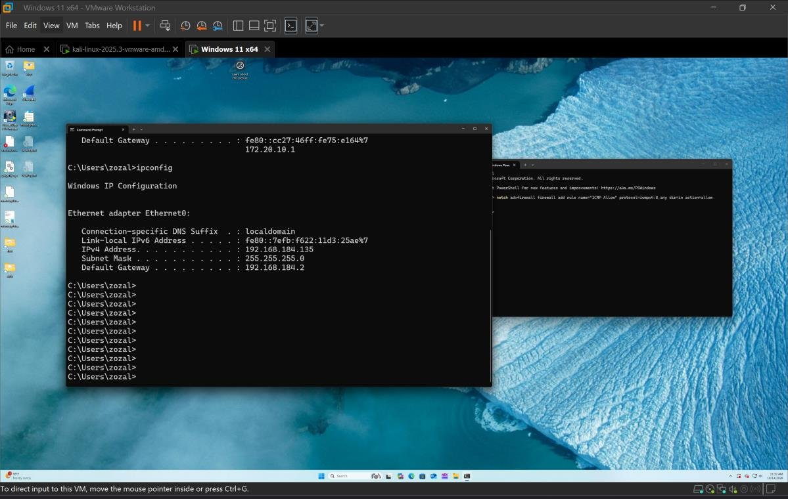
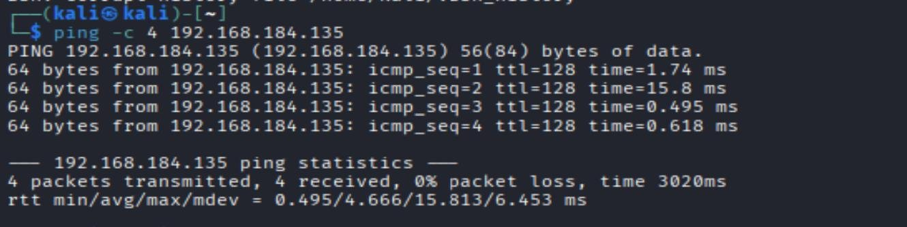
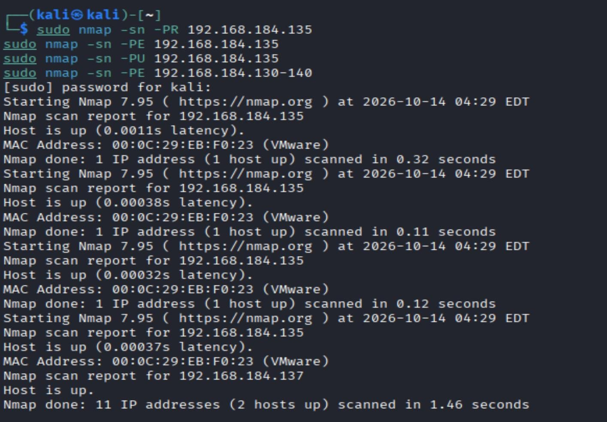
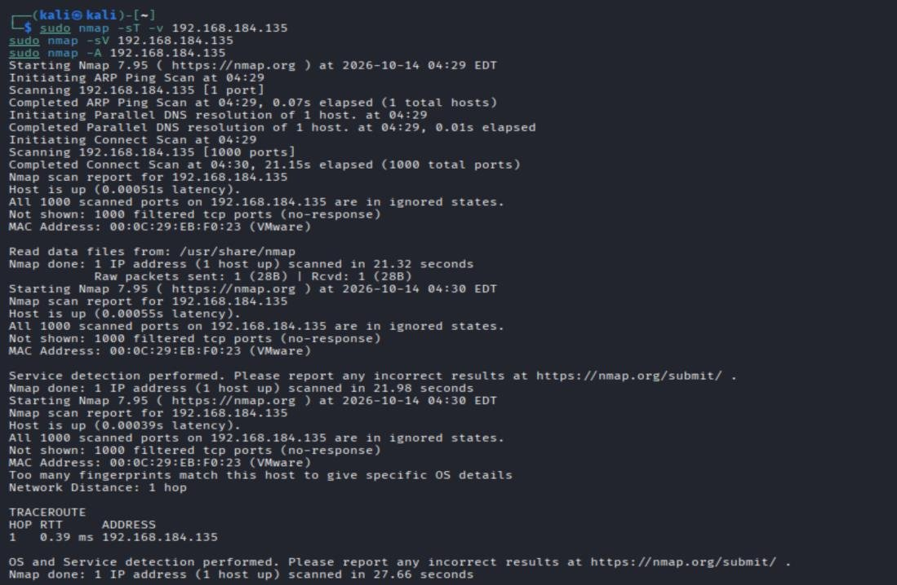
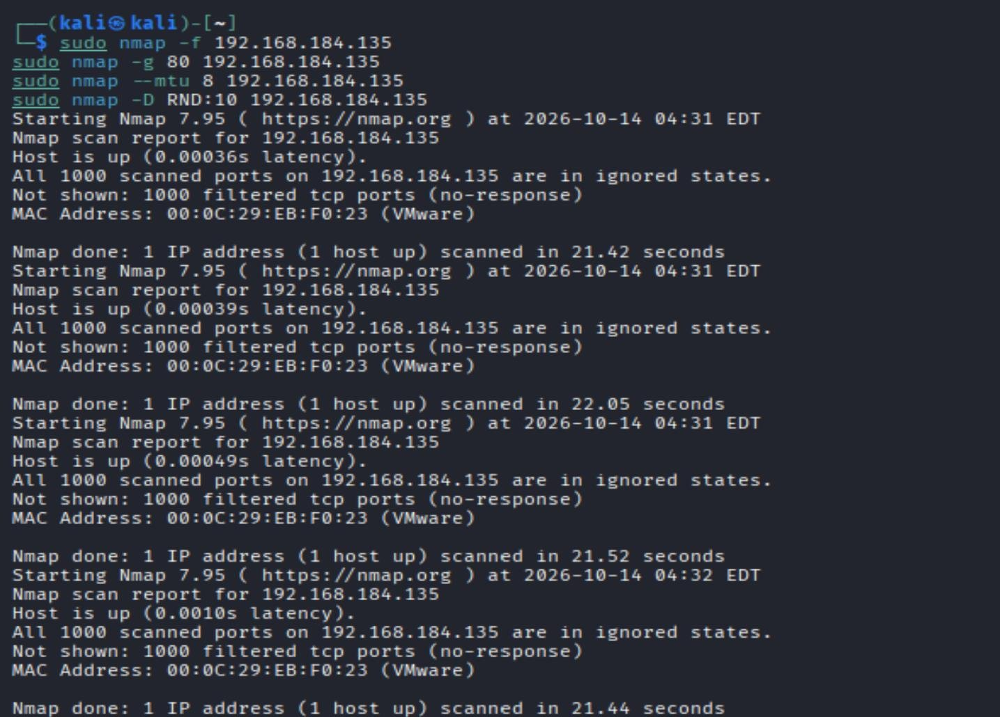
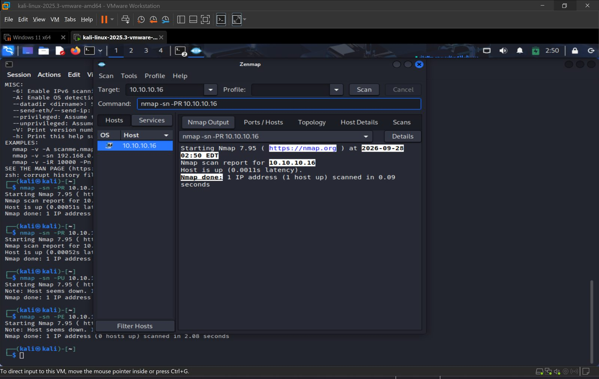
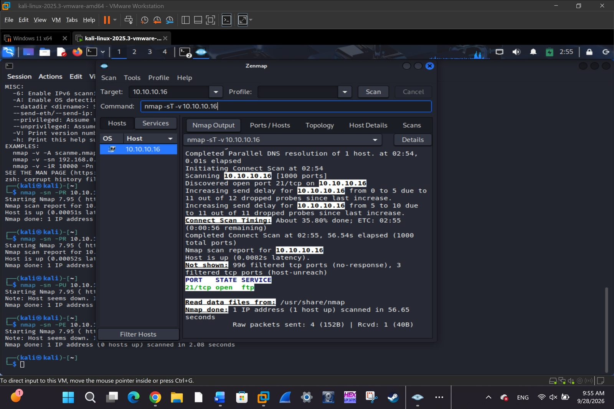
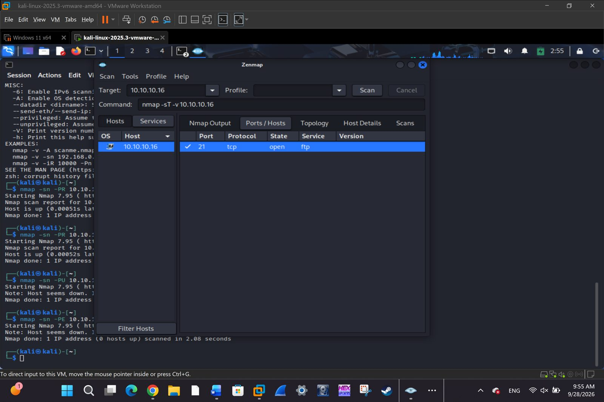
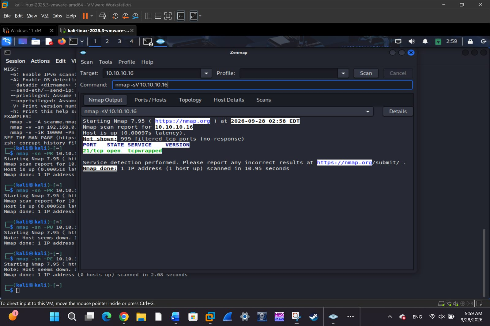

# Lab 02: Network Scanning

**Course:** Ethical Hacking | **Tools:** Nmap, Kali Linux, VMware Workstation | **Target:** Windows 11

## Objective
Scan a target host in an isolated virtual lab: discover live hosts, identify open ports and services, detect service versions and the OS, and attempt firewall/IDS evasion with the target's firewall enabled.

## Environment
| Role | System | Network |
|---|---|---|
| Scanner | Kali Linux 2025.3 | VMware NAT, 192.168.184.0/24 |
| Target | Windows 11 x64 | VMware NAT, 192.168.184.0/24 |

The target was first on a bridged adapter, on a different subnet from the scanner. Switching it to the NAT adapter put both machines on the same subnet.



Connectivity was confirmed with ICMP (4/4 packets, 0% loss):

```bash
ping -c 4 <target-ip>
```



## 1. Host Discovery
Nmap ping scans with port scanning disabled (`-sn`), each using a different probe type, then a ping sweep over an address range:

```bash
sudo nmap -sn -PR <target-ip>          # ARP ping
sudo nmap -sn -PE <target-ip>          # ICMP echo
sudo nmap -sn -PU <target-ip>          # UDP ping
sudo nmap -sn -PE <range>              # ICMP sweep
```

**Result:** The target answered every method, and the ARP scan resolved its MAC address (VMware). The sweep found two live hosts: the target and the scanner.



## 2. Port and Service Discovery

```bash
sudo nmap -sT -v <target-ip>   # TCP connect scan
sudo nmap -sV <target-ip>      # service version detection
sudo nmap -A <target-ip>       # OS detection, scripts, traceroute
```

**Result:** All 1,000 scanned TCP ports were **filtered**. The host was up, but Windows Defender Firewall dropped inbound probes silently instead of answering, so no services were exposed and OS fingerprinting was inconclusive.



## 3. Scanning Beyond IDS and Firewall
With the firewall enabled, four evasion techniques were run as separate scans:

| Technique | Command | Purpose |
|---|---|---|
| Fragmentation | `nmap -f` | Split probes into tiny IP fragments |
| Source port manipulation | `nmap -g 80` | Make probes appear to come from port 80 |
| MTU fragmentation | `nmap --mtu 8` | Fragment packets at a set MTU |
| Decoy scan | `nmap -D RND:10` | Hide the real scanner among 10 spoofed IPs |

**Result:** All ports stayed filtered. The firewall dropped all inbound connections rather than filtering specific traffic, so evasion exposed nothing new.



> `-D` cannot be combined with `-sT` or `-sV`, and `--mtu` should not be used with `-f`, so each technique ran on its own.

## 4. Comparison: Scanning a Server with an Exposed Service
The same techniques were run with Zenmap against a second target, a server on an isolated lab network that exposes a service:

| Scan | Result |
|---|---|
| `nmap -sn -PR` | Host up via ARP |
| `nmap -sT -v` | **21/tcp open** (FTP); the other 999 ports filtered |
| `nmap -sV` | Port 21 identified as `tcpwrapped`: the service accepts the connection and closes it, so no banner or version is revealed |

| ARP discovery | TCP connect scan |
|---|---|
|  |  |

| Open port | Service version |
|---|---|
|  |  |

This contrasts with the Windows 11 target: a single exposed service is immediately visible to a scanner, even when everything else is filtered.

## Key Takeaways
- An enabled host firewall is an effective first line of defense. The host was still discoverable on the local network through ARP and ICMP, but exposed no TCP services.
- Evasion techniques only help when the firewall filters selectively. A default-deny policy defeats them.
- A target running network services, such as Windows Server or Metasploitable 2, is needed to observe open ports.
