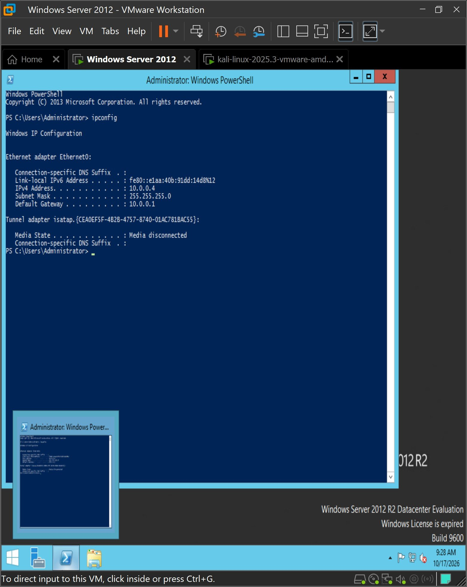
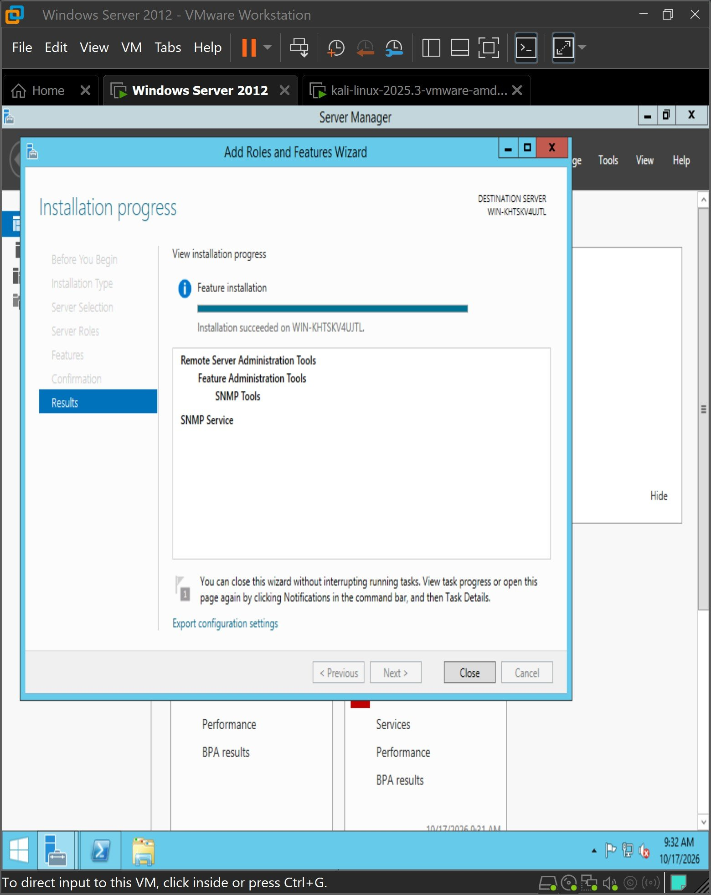
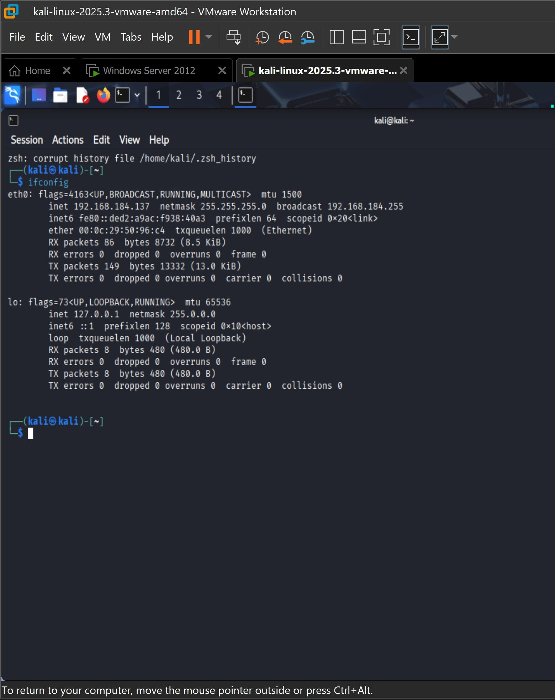
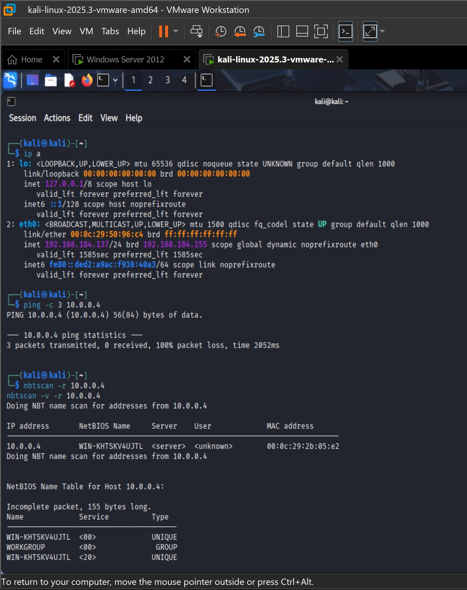
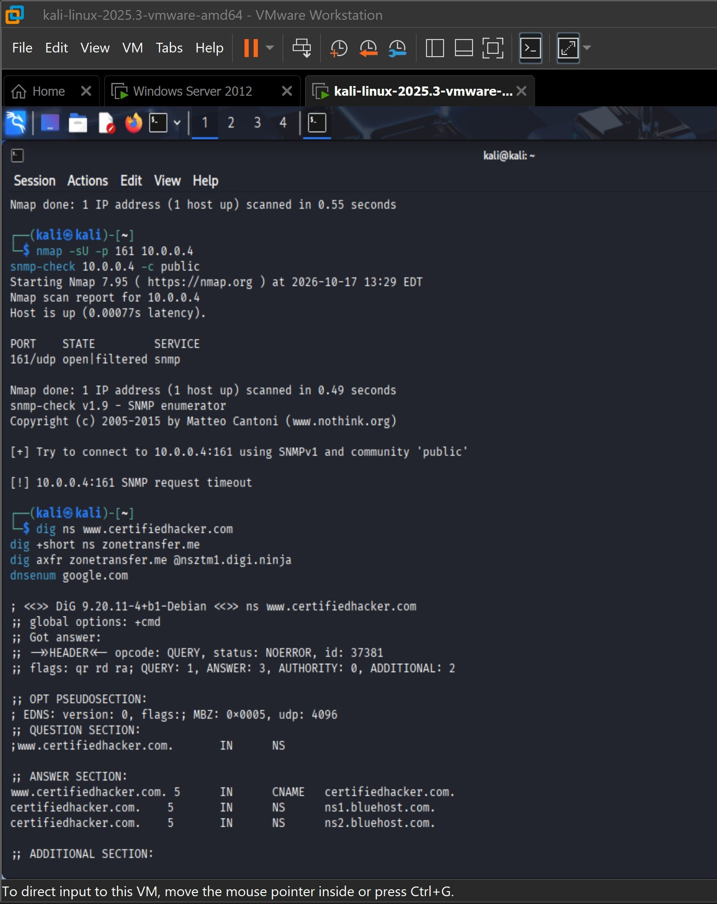
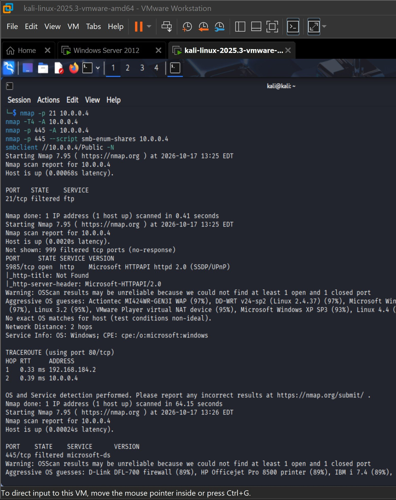
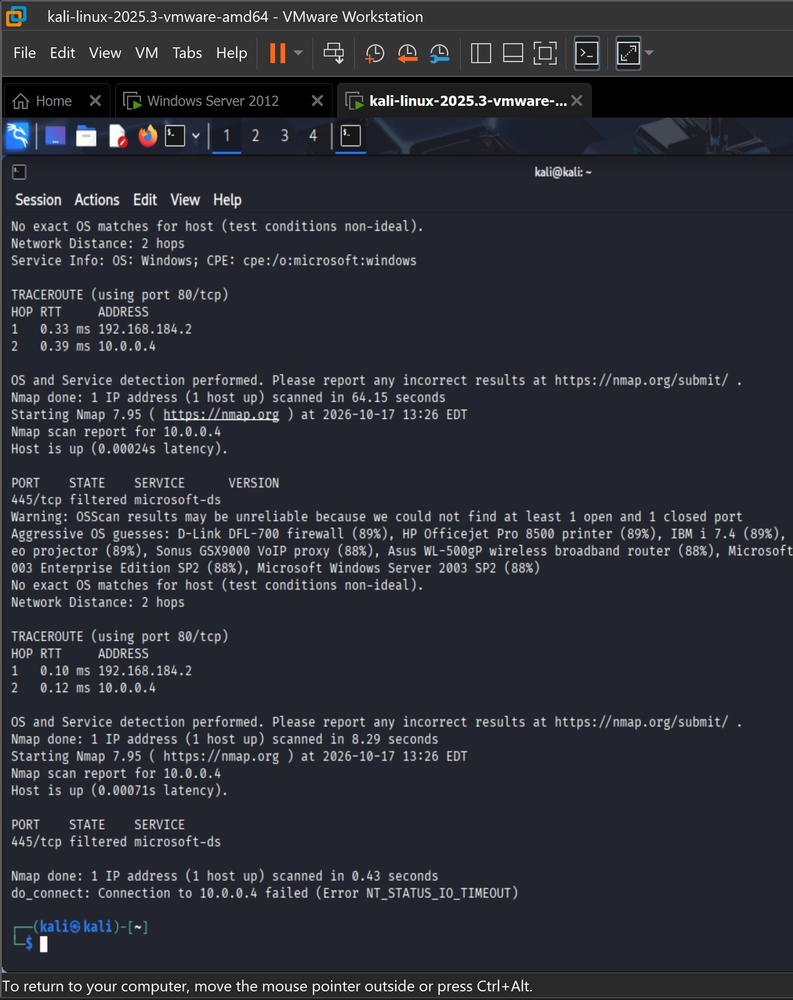
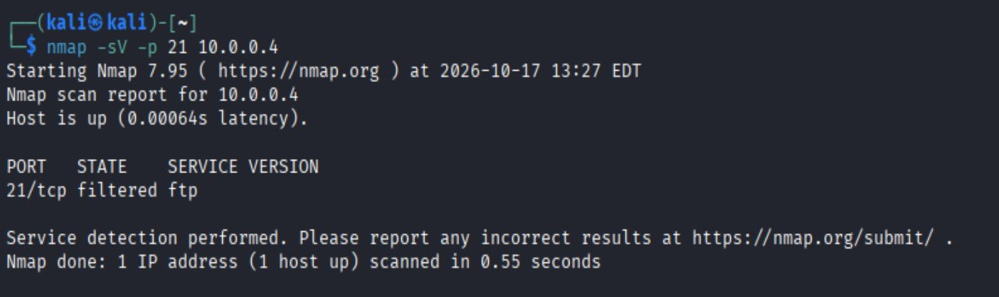
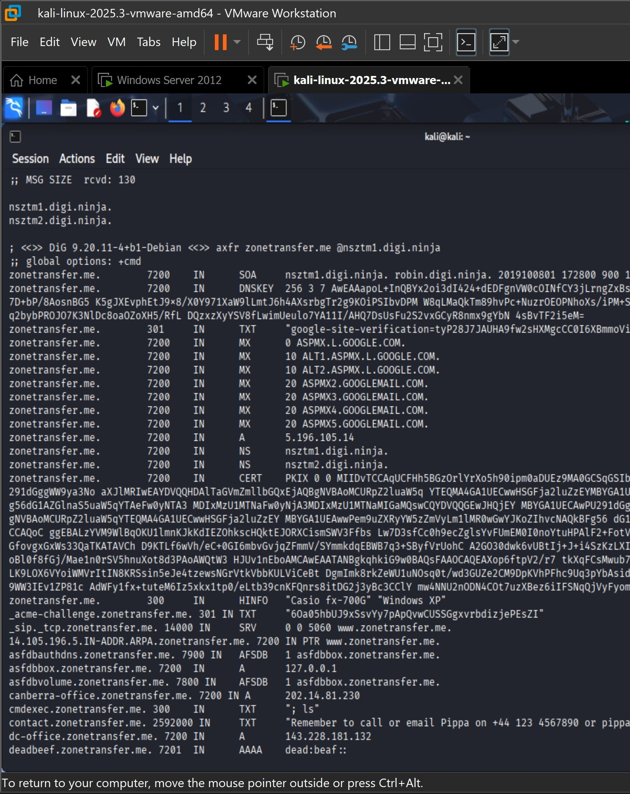
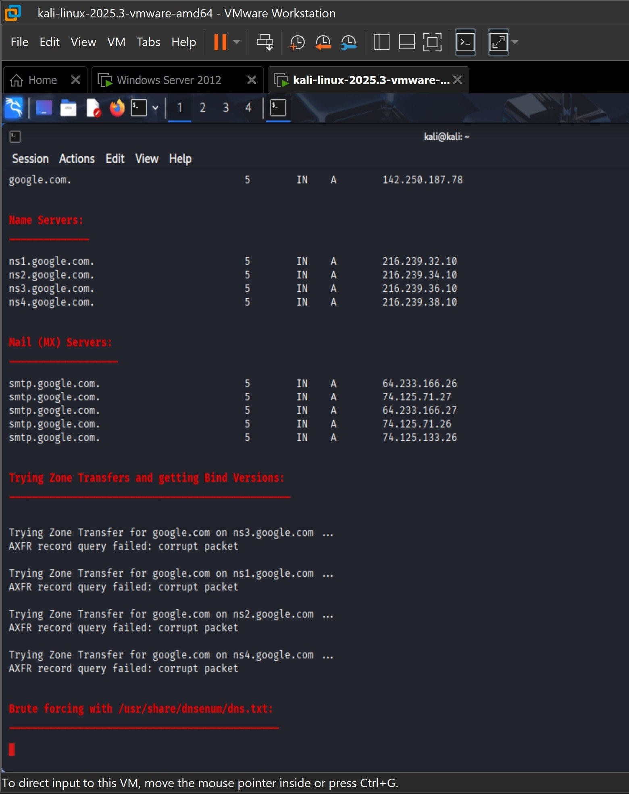

# Lab 03: Enumeration

**Course:** Ethical Hacking | **Tools:** nbtscan, Nmap, snmp-check, smbclient, dig, dnsenum | **Target:** Windows Server 2012 R2

## Objective
Extract information from a target through NetBIOS, SNMP, SMB, FTP, and DNS enumeration, and record what each service reveals or protects.

## Setup
- Identified the target server's IP address with `ipconfig`
- Installed the SNMP Service on Windows Server
- Checked the Kali attacker's IP address with `ifconfig`; the target sits on a different subnet, two hops away

| Target | SNMP installation | Attacker |
|---|---|---|
|  |  |  |

## 1. NetBIOS Enumeration

```bash
nbtscan -r <target-ip>
nbtscan -v -r <target-ip>
```

**Result:** Retrieved the NetBIOS name table: the server's hostname, its `WORKGROUP` membership, and its MAC address. This was all without authentication, even though ICMP ping to the target was blocked.



## 2. SNMP Enumeration

```bash
nmap -sU -p 161 <target-ip>
snmp-check <target-ip> -c public
```

**Result:** UDP 161 was reported `open|filtered`, and `snmp-check` with the `public` community string timed out. The SNMP agent did not answer the default community, so no system data was disclosed.



## 3. SMB and FTP Enumeration

```bash
nmap -p 21 <target-ip>
nmap -T4 -A <target-ip>
nmap -p 445 <target-ip>
nmap -p 445 --script smb-enum-shares <target-ip>
smbclient -L //<target-ip> -N
nmap -sV -p 21 <target-ip>
```

**Result:**
- FTP (21/tcp) and SMB (445/tcp) were **filtered**
- The aggressive scan found **5985/tcp open** (Microsoft HTTPAPI 2.0), the Windows Remote Management (WinRM) port, and identified the OS as Windows
- `smbclient` failed with `NT_STATUS_IO_TIMEOUT`, so no shares were listed

| Port scans | Aggressive scan and smbclient | FTP version |
|---|---|---|
|  |  |  |

## 4. DNS Enumeration

```bash
dig ns certifiedhacker.com
dig axfr zonetransfer.me @nsztm1.digi.ninja
dnsenum google.com
```

**Result:**
- `dig` returned the domain's name servers
- A zone transfer (AXFR) against `zonetransfer.me`, a domain deliberately left open for practice, returned the **entire zone**: mail servers, hosts, TXT records, and internal-looking names
- `dnsenum` against `google.com` collected name servers and mail servers, but every zone transfer attempt **failed**, as expected for a properly configured domain

| Zone transfer (misconfigured) | dnsenum (properly configured) |
|---|---|
|  |  |

## Key Takeaways
- NetBIOS leaked hostname and workgroup details even with ICMP blocked. Disable NetBIOS over TCP/IP where it isn't needed.
- SNMP was protected because it rejected the default `public` community string. Default community strings should always be changed.
- Filtering SMB and FTP at the firewall blocked share enumeration completely.
- An open zone transfer hands an attacker a full map of a domain. Restrict AXFR to authorized secondary name servers.
