# Lab 04: Vulnerability Scanning

**Course:** Ethical Hacking | **Tools:** OpenVAS (Greenbone), Docker, CWE, CVE, NVD | **Target:** Metasploitable 2

## Objective
Research vulnerabilities with public scoring systems and databases, then run an unauthenticated vulnerability scan against an intentionally vulnerable target and recommend remediation.

## Part 1: Vulnerability Research
How the three main references fit together: **CWE** classifies the weakness type, **CVE** identifies a specific published vulnerability, and **NVD** links the two with a CVSS score and affected products.

| Lookup | Finding |
|---|---|
| CWE search: SMB | **CWE-427** Uncontrolled Search Path Element. Exploitable remotely through SMB or WebDAV shares; child of CWE-668 |
| CWE Top 10 KEV (2025) | OS Command Injection (**CWE-78**) ranks first, followed by Use After Free (CWE-416) and Out-of-bounds Write (CWE-787) |
| CVE record | **CVE-2019-16404**: authenticated SQL injection in OpenEMR through 5.0.2 via the `providerID` parameter |
| CVE keyword search: SMB | 1,097 records, the newest being Linux kernel SMB client fixes |
| NVD detail page | Maps a CVE to **CWE-532** (sensitive information in log files) and lists affected CPE configurations |

| CWE-427 | CWE Top 10 KEV | CVE-2019-16404 |
|---|---|---|
| 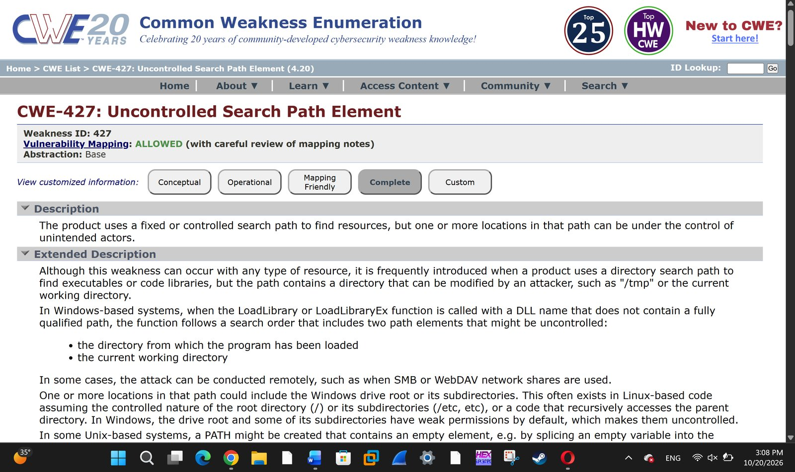 | 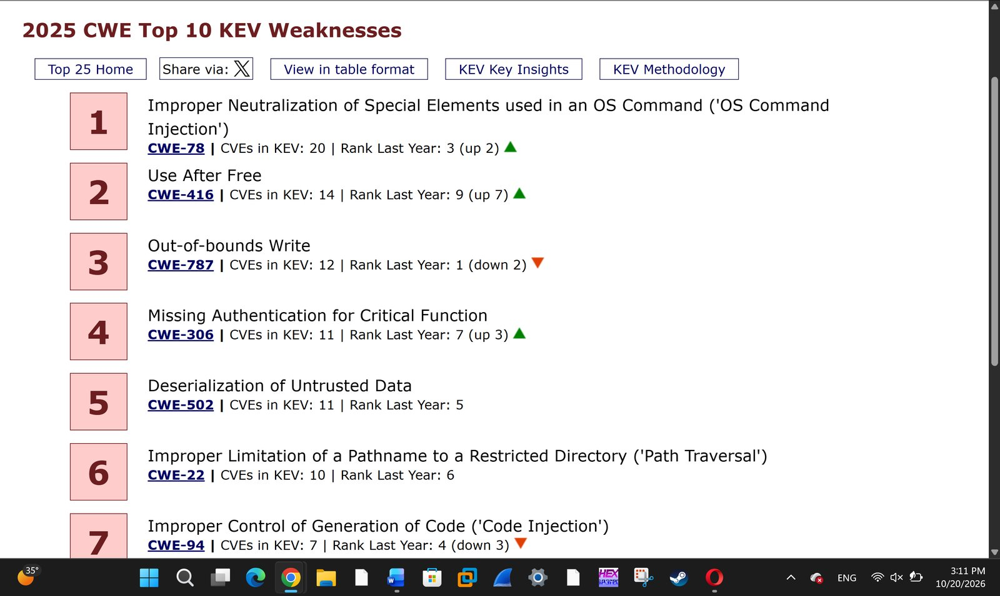 | 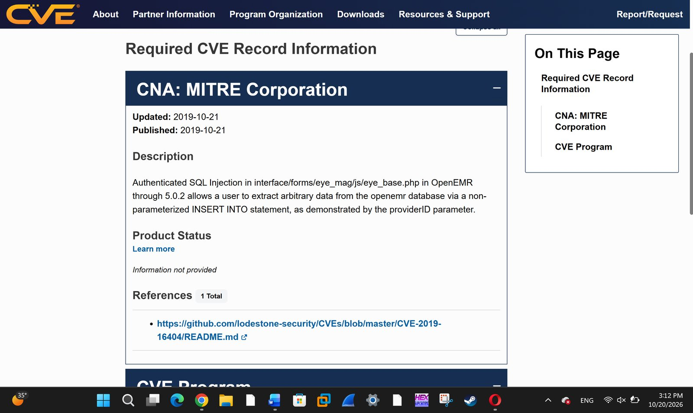 |

| CVE search | NVD detail |
|---|---|
| 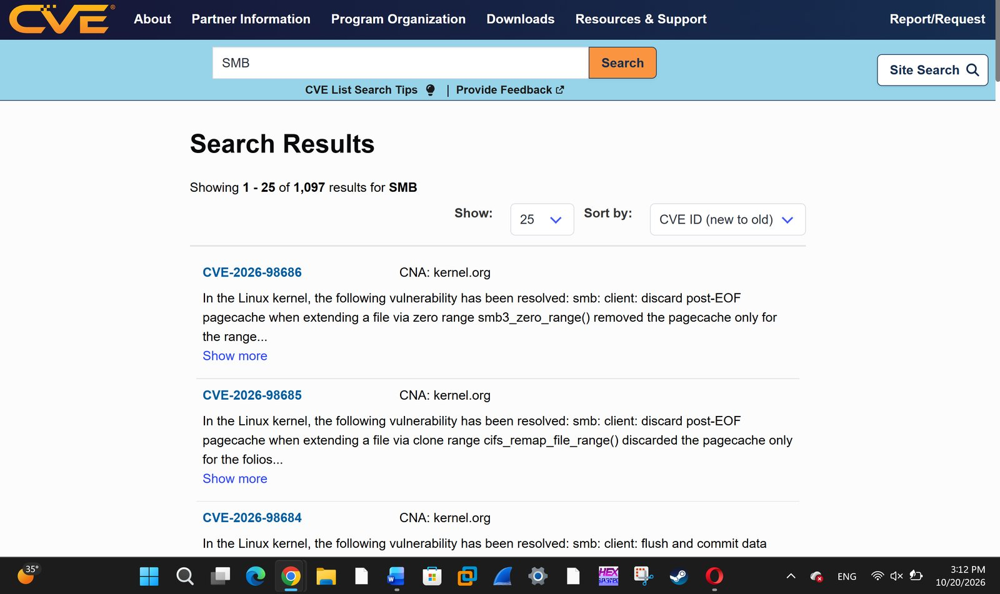 | 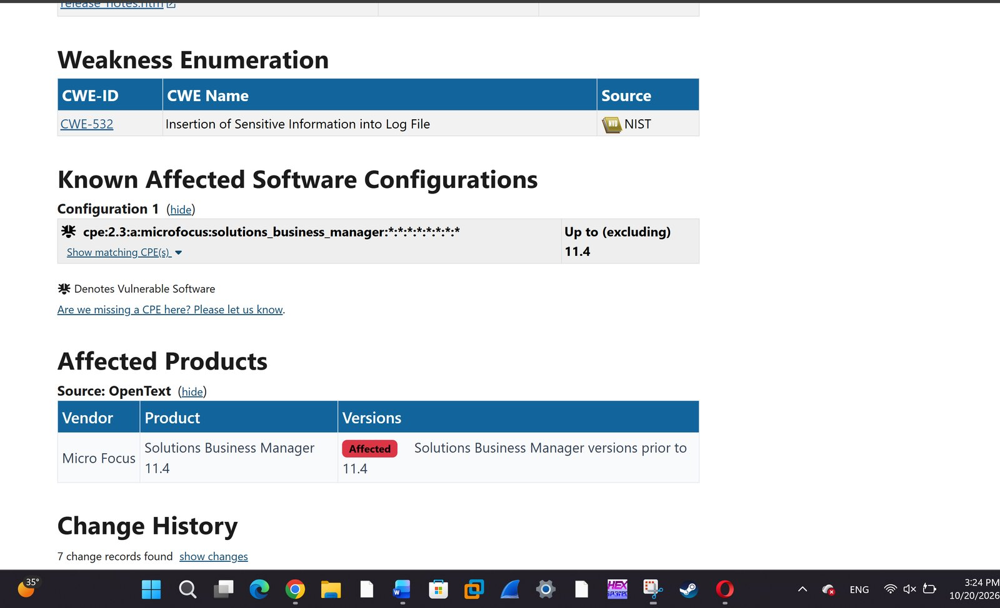 |

## Part 2: Vulnerability Assessment with OpenVAS

### Setup
OpenVAS was run in Docker on Kali:

```bash
sudo apt install docker.io
sudo docker run -d -p 443:443 --name openvas mikesplain/openvas
```

The Greenbone Security Assistant dashboard loaded with the feed in place: **120,352 CVEs** and **49,787 NVTs**.

| Container started | Dashboard | Target |
|---|---|---|
| 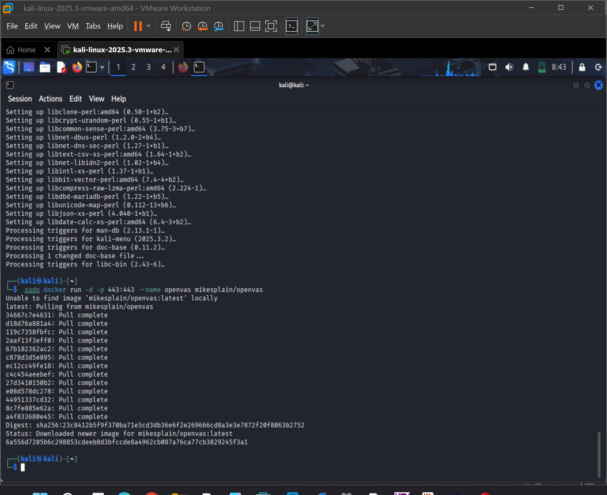 | 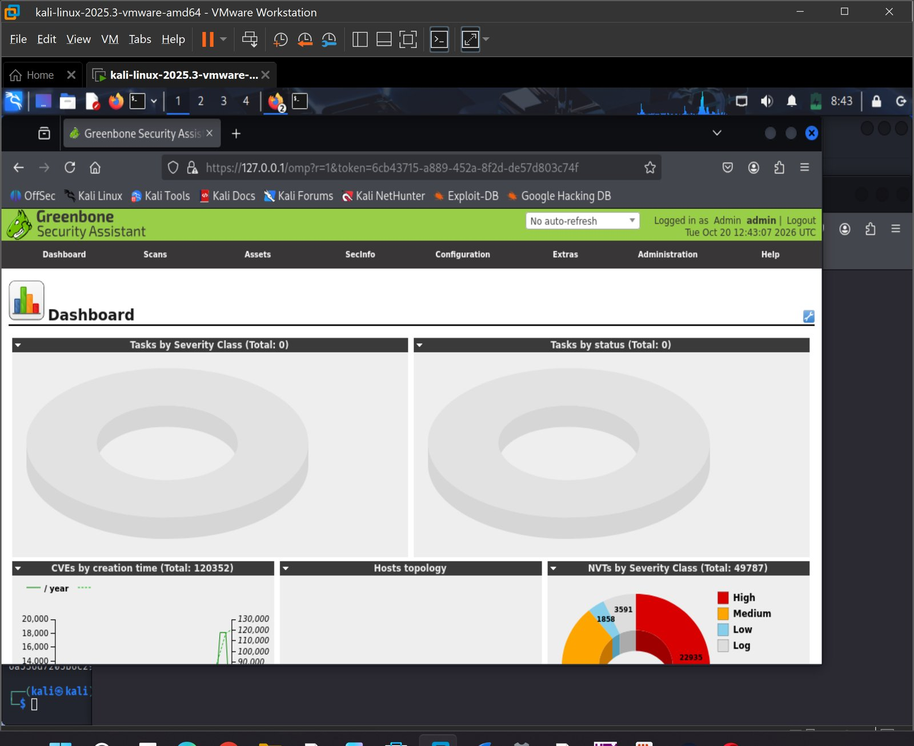 | 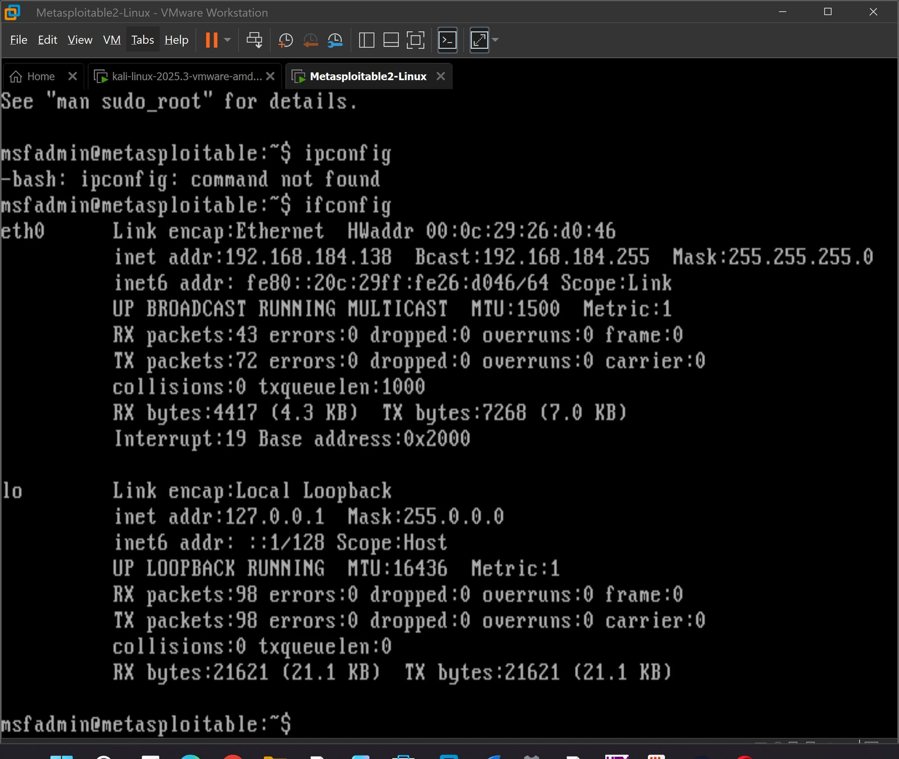 |

### Scan
The Task Wizard created the target and task and started the scan. It completed in about 20 minutes with an overall severity of **10.0 (High)**.

| Task Wizard | Scan complete |
|---|---|
| 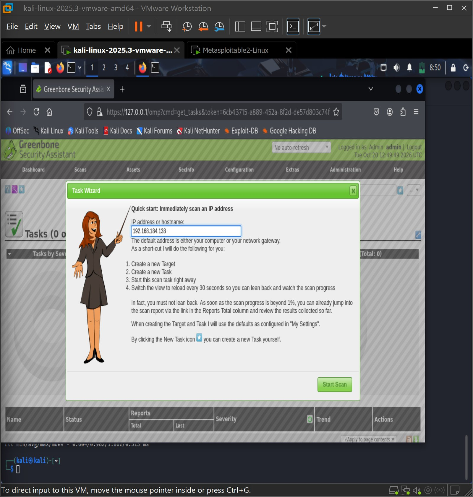 | 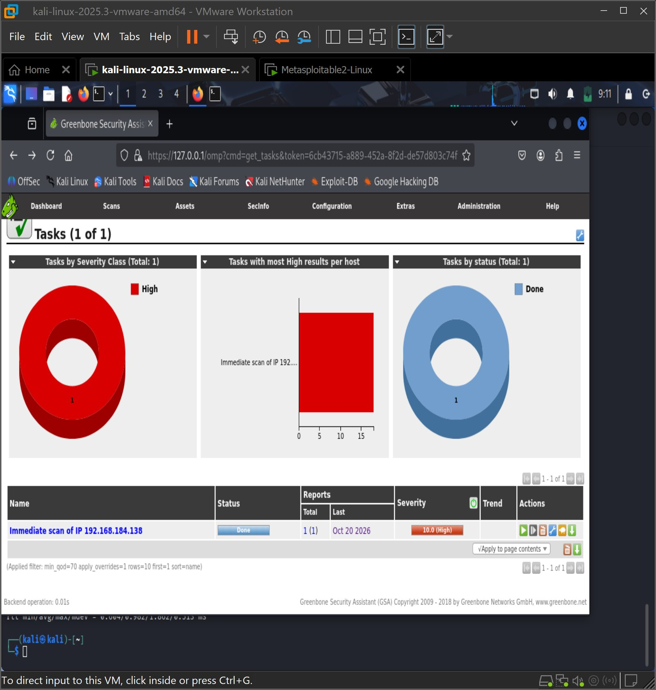 |

### Top Finding: Possible Backdoor (Ingreslock)

| Field | Value |
|---|---|
| Severity | 10.0 (High) |
| Quality of Detection | 99% |
| Location | 1524/tcp |
| Evidence | The service answered `id;` with `uid=0(root) gid=0(root)` |
| Impact | Any unauthenticated attacker can run commands as root and fully compromise the system |

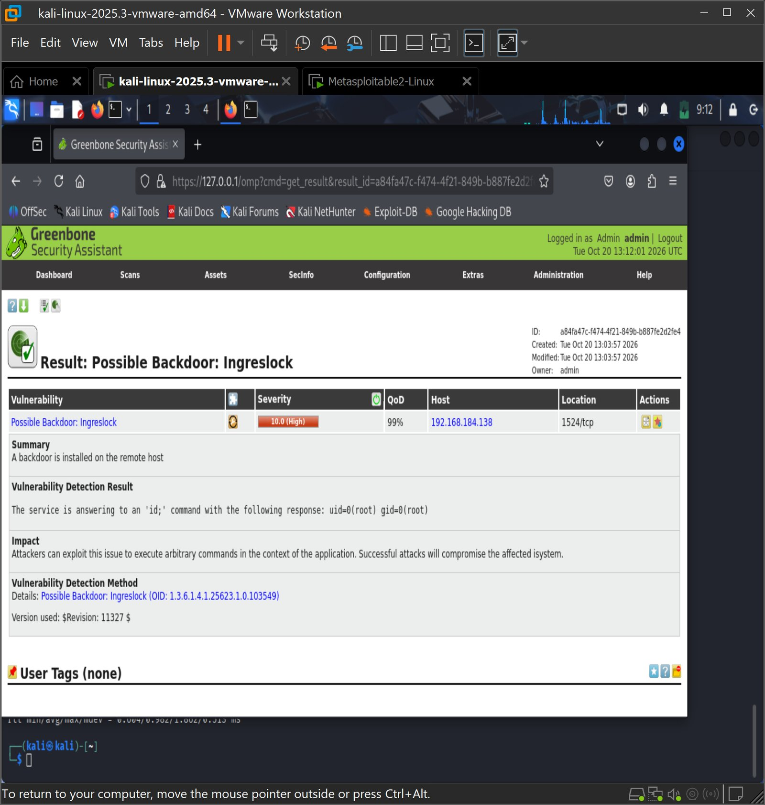

### Remediation
1. Remove or disable the service on 1524/tcp and check the inetd/xinetd configuration for the backdoor entry
2. Block 1524/tcp at the host and network firewall
3. Treat the host as compromised: rebuild from a trusted image and rotate all credentials

## Other Vulnerability Scanners
| Tool | Type | Main use |
|---|---|---|
| Tenable Nessus | Network and web scanner | Finds known vulnerabilities and misconfigurations; ranks them by severity |
| GFI LanGuard | Network scanner and patch manager | Detects vulnerabilities, open ports, and weak passwords; automates patching |
| Nikto | Open-source web server scanner | Checks for outdated versions, dangerous files, and misconfigurations |

## Key Takeaways
- CWE, CVE, and NVD together let a finding be classified, identified, and prioritized.
- OpenVAS found a critical root backdoor that a simple port scan alone would not have confirmed.
- A root-level backdoor means the host should be rebuilt, not patched in place.
